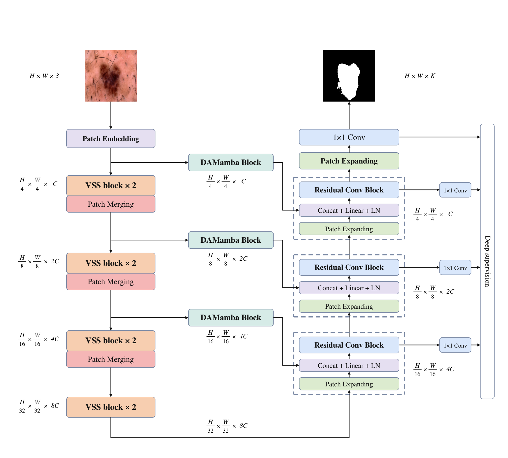
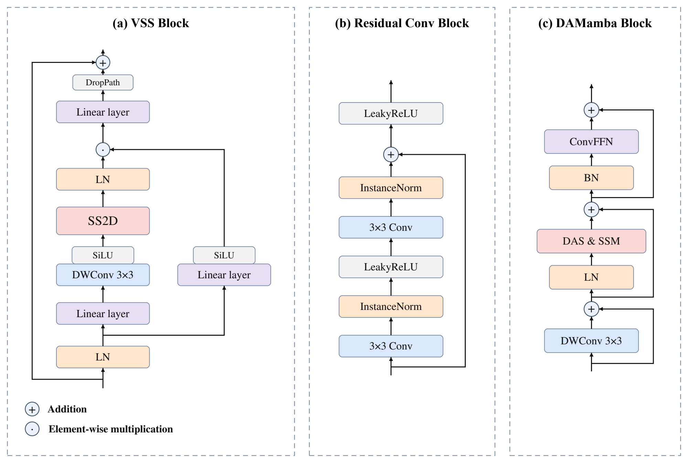

# DAS-VMUNet

## A Deeply Supervised Vision Mamba U-Net with Dynamic Adaptive Scan

**Minh Vu, Owen Nguyen, and Ngoc-Thao Nguyen**  
Faculty of Information Technology, University of Science, Ho Chi Minh City, Vietnam  
Vietnam National University, Ho Chi Minh City, Vietnam

## Abstract

Accurate medical image segmentation requires capturing global contextual information while preserving fine spatial details. Although visual state space models efficiently capture dependencies across distant image regions, integrating multiscale features remains challenging. This paper presents DAS-VMUNet, a deeply supervised Vision Mamba U-Net incorporating Dynamic Adaptive Scan for medical image segmentation. The architecture uses hierarchical visual state space encoding for contextual analysis and convolutional decoding for local feature reconstruction. DAMamba blocks refine features in encoder along skip connections before fusion with the representations of decoder. This refinement aims to preserve useful spatial information in the features passed to the decoder. Deep supervision guides segmentation learning at multiple resolutions during training. Experiments on standard benchmarks, including ISIC17, ISIC18, and Synapse, demonstrate competitive segmentation performance, while using approximately 22.5% fewer parameters than [VM-UNet](https://arxiv.org/abs/2402.02491) in the evaluated skin lesion segmentation configuration. Our code is available at https://github.com/thanhowen2005/DAS-VMUNet.

## Architecture

### Overall architecture



**Figure 1.** VSS encoder, three DAMamba skip pathways, and a CNN decoder with deep supervision.

[Architecture PDF](fig/main_architecture.pdf).

### Building blocks



**Figure 2.** (a) VMamba VSS block; (b) residual CNN block adapted from Swin-UMamba; (c) DAMamba block.

[Building blocks PDF](fig/modules.pdf).

## Repository structure

```text
DAS-VMUNet/
├── configs/
│   ├── config_setting.py             # ISIC17 / ISIC18 configuration
│   └── config_setting_synapse.py     # Synapse configuration
├── datasets/
│   └── dataset.py                   # Dataset loading and augmentation
├── fig/                             # Architecture and building-block figures
├── models/vmunet/
│   ├── vmunet.py                    # Model wrapper and pretrained loading
│   ├── vmamba.py                    # VSS encoder and convolutional decoder
│   ├── damamba_skip.py              # DAMamba skip adapter
│   └── damamba_original/            # Vendored DAMamba and CUDA extensions
├── pre_trained_weights/             # Place the VMamba-S checkpoint here
├── results/                         # Training runs, logs, and predictions
├── engine.py                        # ISIC training and evaluation
├── engine_synapse.py                # Synapse training and evaluation
├── train.py                         # ISIC entry point
├── train_synapse.py                 # Synapse entry point
└── utils.py                         # Losses, metrics, and utilities
```

## Installation

### Main environments

Follow the environment setup used by [VM-UNet](https://github.com/JCruan519/VM-UNet#0-main-environments):

```bash
conda create -n das-vmunet python=3.8
conda activate das-vmunet
pip install torch==1.13.0 torchvision==0.14.0 torchaudio==0.13.0 --extra-index-url https://download.pytorch.org/whl/cu117
pip install packaging
pip install timm==0.4.12
pip install pytest chardet yacs termcolor
pip install submitit tensorboardX
pip install triton==2.0.0
pip install causal_conv1d==1.0.0
pip install mamba_ssm==1.0.1
pip install scikit-learn matplotlib thop h5py SimpleITK scikit-image medpy yacs
pip install einops numpy scipy pillow ninja wheel
```

VM-UNet provides compatible wheels via [Baidu](https://pan.baidu.com/s/1Tibn8Xh4FMwj0ths8Ufazw?pwd=uu5k) or [Google Drive](https://drive.google.com/drive/folders/1ZJjc7sdyd-6KfI7c8R6rDN8bcTz3QkCx?usp=sharing). Match the wheel to your Python, PyTorch, CUDA, and platform.

Run all commands from the repository root with the environment activated. Extension builds require CUDA-enabled PyTorch and the CUDA Toolkit (`nvcc`).

### Build the DAMamba extensions

```bash
python -m pip install --no-build-isolation --no-deps ./models/vmunet/damamba_original/selective_scan
python -m pip install --no-build-isolation --no-deps ./models/vmunet/damamba_original/ops_dcnv3
```

## Data preparation

Use the datasets and splits provided by the [VM-UNet authors](https://github.com/JCruan519/VM-UNet#1-prepare-the-dataset). Place them under `data/` as shown below.

### ISIC17 and ISIC18

Train/test splits: **1,500/650** for ISIC17 and **1,886/808** for ISIC18. Store held-out pairs in `val/`.

```text
data/
├── isic2017/
│   ├── train/
│   │   ├── images/
│   │   └── masks/
│   └── val/
│       ├── images/
│       └── masks/
└── isic2018/
    ├── train/
    │   ├── images/
    │   └── masks/
    └── val/
        ├── images/
        └── masks/
```

Match images and masks by sorted filename order; use grayscale masks with values 0/255.

Select `'isic17'` or `'isic18'` in `configs/config_setting.py`. Default paths are `./data/isic2017/` and `./data/isic2018/`; retain the trailing slash when changing them.

### Synapse

Synapse: **18 training / 12 test volumes**, with nine classes including background.

```text
data/Synapse/
├── train_npz/
│   └── caseXXXX_sliceXXX.npz
├── test_vol_h5/
│   └── caseXXXX.npy.h5
└── lists/
    └── lists_Synapse/
        ├── train.txt
        └── test_vol.txt
```

Both formats contain `image` and `label` arrays. List sample IDs without extensions in the split files.

Default paths in `configs/config_setting_synapse.py`:

```python
data_path = './data/Synapse/train_npz/'
volume_path = './data/Synapse/test_vol_h5/'
list_dir = './data/Synapse/lists/lists_Synapse/'
```

## Pretrained encoder

Download VMamba-S weights from the [VM-UNet authors](https://github.com/JCruan519/VM-UNet#2-prepare-the-pre_trained-weights) and place `vmamba_small_e238_ema.pth` in `pre_trained_weights/`.

Default in both configurations:

```python
model_config = {
    # Keep the remaining model configuration fields.
    'load_ckpt_path': './pre_trained_weights/vmamba_small_e238_ema.pth',
}
```

The checkpoint must contain a `model` dictionary for encoder initialization.

## Training

After preparing data and weights, run:

```bash
# ISIC17 or ISIC18, selected in configs/config_setting.py
python train.py

# Synapse
python train_synapse.py
```

### Outputs and checkpoint selection

Runs are saved under `work_dir` (default: `results/`):

```text
results/<run_name>/
├── checkpoints/
│   ├── latest.pth
│   └── best-epoch*.pth
├── log/
├── summary/
└── outputs/
```

Selected weights are saved as `best.pth` and renamed to `best-epoch*.pth` after evaluation.

Checkpoint selection uses held-out loss for ISIC and training loss for Synapse. Synapse test metrics are logged every `val_interval` epochs and do not select the checkpoint.

### Resume training

For Synapse, set `resume_path` to `checkpoints/latest.pth` from the previous run. For ISIC, reuse that run's `work_dir`.

`latest.pth` restores training state, including the AMP scaler for Synapse when available.

## Evaluation and prediction export

Set these fields in the dataset configuration:

```python
only_test_and_save_figs = True
best_ckpt_path = '/path/to/best-epochXXX.pth'
img_save_path = './prediction_results/'
```

Run:

```bash
python train.py          # ISIC17 / ISIC18
python train_synapse.py  # Synapse
```

Use `best-epoch*.pth` for evaluation, not `latest.pth`. Keep dataset paths available. Synapse exports NIfTI predictions; ISIC uses a default threshold of `0.5`.

## Acknowledgments

Built on [VM-UNet](https://github.com/JCruan519/VM-UNet), [VMamba](https://github.com/MzeroMiko/VMamba), [Swin-UMamba](https://github.com/JiarunLiu/Swin-UMamba), and [DAMamba](https://github.com/ltzovo/DAMamba). We thank their authors for the code and pretrained weights.

